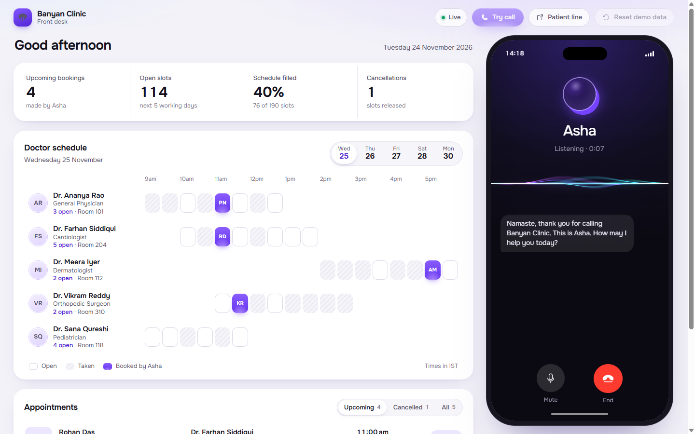
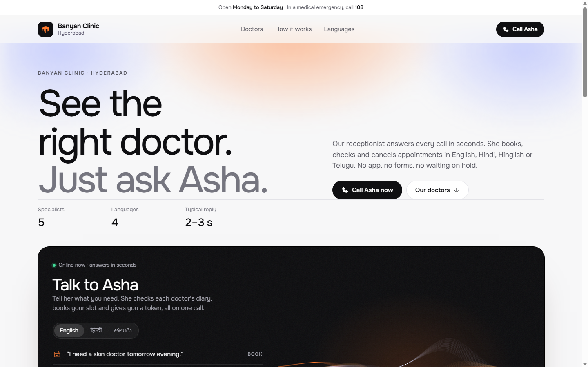
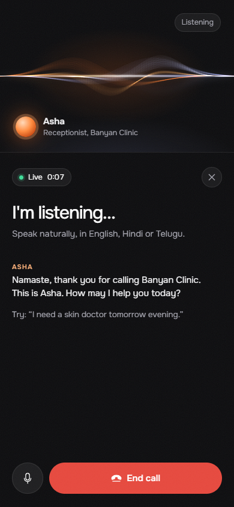

# Banyan Clinic: Asha, a voice receptionist for doctor appointments

Call Asha from the browser and talk to her as you would to a clinic's front desk. She checks a doctor's free slots, books an appointment and cancels it, all by voice and in one call. She identifies you only by the mobile number you say, and reads it back before she books or cancels. She understands English, Hindi, Hinglish and Telugu.



| Patient line (`/`) | Phone call on mobile |
|---|---|
|  |  |

## Stack

| Part | Choice |
|---|---|
| Voice pipeline | [Pipecat](https://github.com/pipecat-ai/pipecat) 1.17 (Python), SmallWebRTC transport (browser ↔ server WebRTC, no third-party room service) |
| Speech to text | ElevenLabs Scribe v2 Realtime, streamed over a websocket, with automatic language detection |
| LLM | Google Gemini `gemini-3.5-flash-lite` (free tier), with `gemini-3-flash-preview` as a backup when it is slow |
| Text to speech | ElevenLabs Flash v2.5, voice "Tara" (Indian English and Hindi) |
| Turn taking | Silero VAD plus Pipecat's Smart Turn v3 model |
| Data | SQLite: 5 doctors, 30-minute slots for the next 5 working days |
| Frontend | React 19, Vite, TypeScript, Pipecat client SDK, anime.js |

## What it does

**Voice pipeline**
- The three required tools, registered with Pipecat function calling: `check_doctor_availability`, `book_appointment`, `cancel_appointment`. There are two extra tools: `find_my_appointments` and `end_call`.
- The read-back cannot be skipped. `book_appointment` and `cancel_appointment` take a required `phone_confirmed` argument, and the server refuses the action unless it is true. A prompt alone can be ignored; this check cannot.
- One call can cover booking, checking and cancelling. The caller can say "a skin doctor" or "my kid has a fever" instead of a doctor's name, and Asha maps it to a speciality.
- Asha answers in the caller's language. The short "One moment, let me check" holding lines and the goodbye switch to Hindi too.

**Dashboard**
- There are two pages. `/` is the patient line. `/desk` is the staff dashboard: stats, a doctor × slot schedule board, the appointment list and live activity.
- **Try call** on the desk opens a phone on screen. It goes from ringing to connected to ended, and shows a call timer, mute and end-call buttons, the live transcript in chat bubbles, and a waveform that reacts to both voices. When Asha books, a confirmation token appears inside the phone.
- The schedule and appointment rows update and highlight as soon as Asha books or cancels, pushed over Server-Sent Events.
- Ringback (the Indian 400/450 Hz pattern), hang-up and confirmation sounds are generated with Web Audio.
- On a phone-sized screen the call takes the full screen. Animations respect `prefers-reduced-motion`.

## Run it

You need Python 3.11+, Node 20+, an [ElevenLabs API key](https://elevenlabs.io/app/settings/api-keys) with Speech to Text and Text to Speech access, and a [Gemini API key](https://aistudio.google.com/apikey).

```bash
cp .env.example .env          # paste in the two keys

# 1. voice agent + API on :7860
cd server
python -m venv .venv
source .venv/bin/activate     # Windows: .venv\Scripts\activate
pip install -r requirements.txt
uvicorn app:app --port 7860

# 2. dashboard on :5173 (second terminal)
cd web
npm install
npm run dev
```

- Patient line: http://localhost:5173. Allow the microphone and press **Call Asha**.
- Staff desk: http://localhost:5173/desk. Press **Try call**, or keep it open in a second window while calling from the patient line.

**One port instead of two:** run `npm run build` in `web/`. The server then serves both pages at http://localhost:7860.

### Try this

1. "I need a skin doctor tomorrow evening."
2. Pick a time and give your name and a 10-digit mobile number. Say yes when she reads it back.
3. Watch the slot fill on the schedule and the booking token appear in the phone.
4. "Actually, please cancel it." Give the same number.

**Reset demo data** in the desk header reseeds the database.

## How it works

```
browser mic ──WebRTC──▶ transport.input ──▶ ElevenLabs Scribe v2 Realtime (Silero VAD + Smart Turn end the turn)
                                                   │
                                                   ▼
                        user context ──▶ Gemini ──tool call──▶ tools.py ──▶ SQLite
                                           │                      ├──▶ SSE ──────────────▶ staff desk
                                           ▼                      └──▶ RTVI data channel ─▶ caller's booking token
                                    ElevenLabs TTS
                                           │
browser speaker ◀──WebRTC── transport.output ──▶ assistant context
```

| File | What it does |
|---|---|
| `server/bot.py` | Builds the Pipecat pipeline for one call, and the hedged Gemini service |
| `server/tools.py` | Tool schemas the LLM sees, and the handlers that run |
| `server/prompt.py` | Asha's instructions, with today's date and the doctor list |
| `server/db.py` | SQLite schema, seed data, booking and cancelling |
| `server/app.py` | WebRTC signalling (`/api/offer`), REST for the dashboard, `/api/events` SSE stream |
| `server/stt.py` | Optional local Whisper speech to text (see below) |
| `web/src/useCall.ts` | Call lifecycle, live transcript, mute, audio routing, sounds |
| `web/src/DeskApp.tsx`, `web/src/components/PhoneCall.tsx` | Staff dashboard and its on-screen phone |
| `web/src/PatientApp.tsx`, `web/src/components/Console.tsx` | Patient page and its call console |
| `web/src/components/Ribbons.tsx` | Waveform canvas driven by live mic and agent audio levels |

### Pipeline in short

Audio from the browser reaches the server over WebRTC and streams to ElevenLabs Scribe, which returns text as the caller speaks. Silero VAD hears the pause, and Smart Turn decides whether the sentence is finished. The final transcript goes to Gemini together with the conversation so far and five tool definitions. When Gemini calls a tool, the handler queries SQLite and publishes an event so the dashboard updates during the call. Gemini then phrases the answer, ElevenLabs turns it into speech, and the audio goes back over WebRTC. Pipecat's RTVI messages carry the transcript to the browser.

## Latency

Measured on scripted calls through the real WebRTC server, from the moment the caller stops talking to the moment Asha starts speaking: **1.6–3.4 s, typically about 2.4 s**, in English and Hindi.

- **Gemini stalls.** Flash-Lite sometimes stalls for 5–20 s at busy hours. `HedgedGoogleLLMService` sends the same request to a second model if nothing arrives within 1 s, and uses whichever starts answering first.
- **Holding lines.** When a tool runs, Asha says a short holding line at once, so the caller never sits in silence.
- **Turn detection.** Smart Turn's wait after an unfinished-sounding phrase is capped at 1.2 s instead of 3 s.

## Design notes

- **Privacy split.** The staff desk listens to `/api/events`, which carries every booking. The patient page never does: a caller's own booking token arrives over their call's WebRTC data channel.
- **Data rules.** The database allows one live booking per slot (a partial unique index). It refuses slots in the past and a second booking with the same doctor for the same number. Phone numbers are normalised to 10 digits: `+91` and a leading `0` are stripped, and the number must start with 6–9.
- **Timezone.** The clinic runs on IST, whatever the machine's timezone is.
- **Telugu.** Scribe transcribes Telugu well, but the TTS voice cannot speak it, so Telugu callers are answered in English.
- **Local Whisper (optional).** If a machine has an NVIDIA GPU, `pip install -r requirements-whisper.txt` and `STT_ENGINE=whisper` run Whisper `large-v3-turbo` locally instead of Scribe. There is no STT cost, but replies are about 1 s slower.

## Limits

- The staff desk has no login. Anyone who can reach the server can see `/desk` and the `/api` data, so put it behind authentication before real use.
- One server process holds the call state. That is fine for a demo; horizontal scaling would need a shared event bus.
- On slow turns the backup model doubles the LLM cost. The preview model has a low rate limit, and when it is hit the main model still answers.
